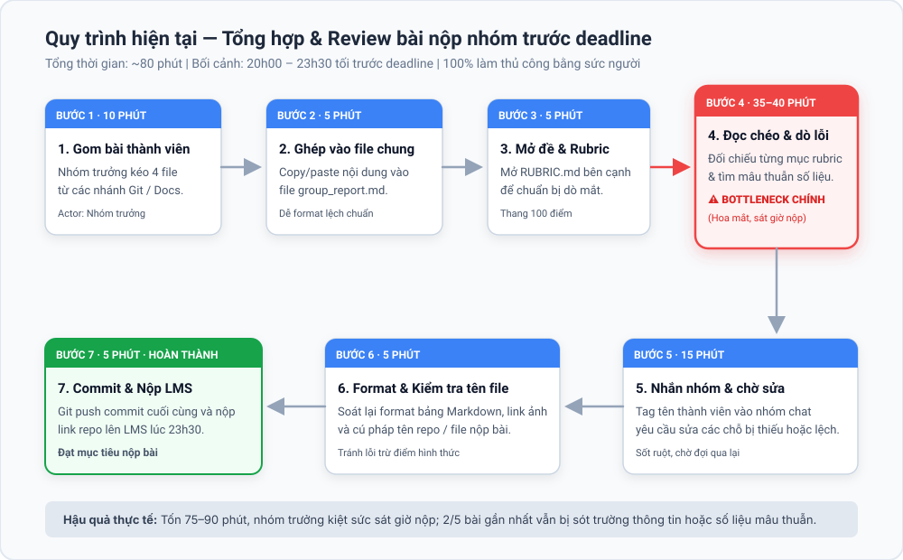
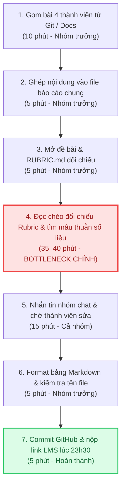
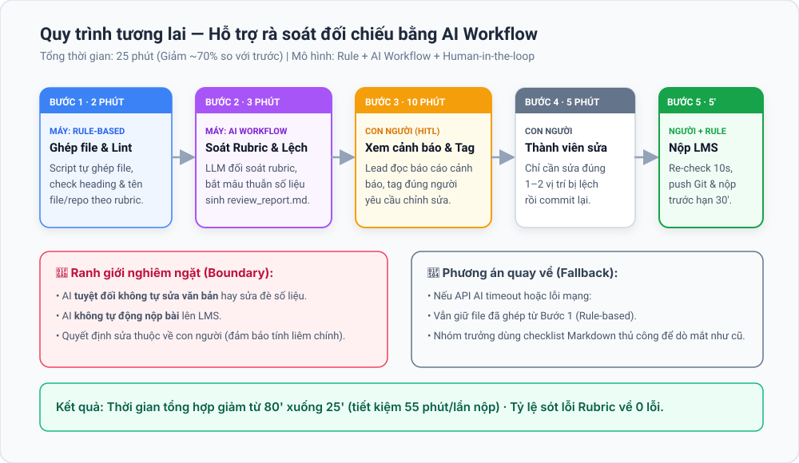
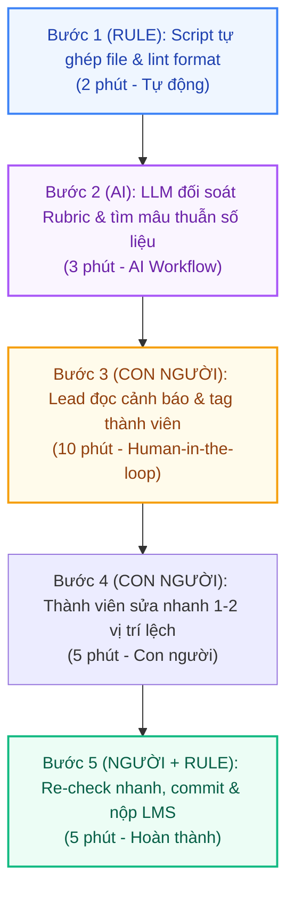

# Báo cáo nhóm — Day 02 Discovery & Problem Framing

> Bản chung của nhóm, viết trên repo do nhóm trưởng fork. Không copy file này sang repo cá nhân.
> Template chi tiết và prompt mẫu: [docs/01-worksheet.md](../../docs/01-worksheet.md). Bài mẫu: [docs/02-deliverable-example.md](../../docs/02-deliverable-example.md).

## 1. Thông tin nhóm

- Tên nhóm:
- Thành viên: xem `TEAM.md`
- Candidate problem được chọn (1 câu):
- Quyết định cuối: Go / Not Yet / No-Go

---

## 2. Hội tụ nhóm (CP3)

### 2.1. Pitch

| # | Người đưa ra | Candidate (Job Story ngắn) | Actor | Bottleneck | Câu hỏi phản biện nhận được (ai hỏi) |
|---:|---|---|---|---|---|
| 1 | | | | | |
| 2 | | | | | |
| 3 | | | | | |
| 4 | Nguyễn Lâm Tùng | Khi ghép code/báo cáo từ 4 thành viên vào tối trước ngày nộp, nhóm trưởng muốn biết ngay phần nào viết lệch cấu trúc hoặc mâu thuẫn số liệu với phần khác, để kịp yêu cầu sửa trước khi merge | Nhóm trưởng, các thành viên nhóm (4 người) | Đọc dò chéo để phát hiện mâu thuẫn số liệu, logic và thuật ngữ giữa 4 phần viết độc lập (35 phút) | *"Nếu nhóm chia sẵn khung heading trong file template từ đầu buổi thì có còn mất 80 phút ghép bài nữa không, hay chủ yếu mất giờ ở chỗ khác?"* (Dương hỏi) |
| 5 | Nguyễn Lâm Tùng | Khi chuẩn bị nộp bài lab/báo cáo nhóm trước deadline 23h59, tôi muốn đối chiếu nhanh bài làm với toàn bộ rubric và quy tắc đặt tên file, để không bị trừ điểm oan vì thiếu mục nhỏ | Sinh viên, nhóm trưởng chuẩn bị nộp bài | Dò thủ công từng điều kiện đạt/trừ điểm trong `RUBRIC.md` và `SUBMISSION.md` đối chiếu với bài làm (15 phút) | *"Phần kiểm tra tên file và số dòng này chỉ cần lập Checklist hoặc chạy script/linter (Rule) là đủ, có thực sự cần tới AI không?"* (Thành viên 3 hỏi) |
| 6 | Nguyễn Lâm Tùng | Khi giảng viên hoặc TA giải đáp thắc mắc rải rác trong Zalo/Discord lớp suốt nhiều tuần, tôi muốn tìm lại ngay câu trả lời chính thức cho lỗi mình đang gặp, để không mất công hỏi lại hoặc làm sai hướng | Sinh viên trong lớp, Trợ giảng (TA) | Cuộn đọc ngược qua >500 tin nhắn thảo luận để tìm đúng câu chốt của giảng viên/TA (10 phút) | *"Nếu TA hoặc lớp trưởng chỉ cần ghim (Pin) tin nhắn giải đáp vào một file Google Docs FAQ chung (No AI) thì đã giải quyết được 80% vấn đề chưa?"* (Thành viên 4 hỏi) |
| 7 | Đỗ Duy Tùng | Khi đến giờ họp daily standup lúc 9h sáng, tôi muốn tổng hợp nhanh commit, ticket Jira và ghi chú hôm qua, để báo cáo trong 2 phút mà không phải lục lọi lịch sử | Kỹ sư phần mềm Agile | Mở 3 công cụ (Git, Jira, Slack) lúc 8h45 để nhớ lại việc hôm qua, mất 15–20' | Viết script regex lấy log Git là xong, sao cần AI? (Thành viên 2) |
| 8 | Đỗ Duy Tùng | Khi nhận tài liệu đặc tả nghiệp vụ GovTech có nhiều quy định mập mờ, tôi muốn phát hiện sớm các kịch bản ngoại lệ (edge cases) và mâu thuẫn logic, để gửi danh sách câu hỏi làm rõ cho khách hàng | Kỹ sư GovTech / BA | Tự tìm kịch bản ngoại lệ và đối chiếu mâu thuẫn quy định thủ công, mất 105' | Nghiệp vụ nhà nước có tính bảo mật cao, đưa vào AI xử lý có vi phạm chính sách dữ liệu không? (Thành viên 1) |
| 9 | Đỗ Duy Tùng | Khi đọc tài liệu kỹ thuật API và thư viện AI mới bằng tiếng Anh chuyên ngành, tôi muốn nắm đúng bản chất khái niệm cốt lõi bằng tiếng Việt chuyên môn, để áp dụng vào code mà không phải mất cả buổi tra từ điển | Kỹ sư học AI | Đọc bản dịch thô và thử sai do hiểu nhầm tài liệu kỹ thuật, mất 75' | Google Dịch và Claude/ChatGPT đã dịch được rồi, nhóm định làm gì khác biệt? (Thành viên 4) |
| 10 | | | | | |
| 11 | | | | | |
| 12 | | | | | |

### 2.2. Cluster

| Cluster | Các candidate | Pattern chung |
|---|---|---|
| A | | |
| B | | |
| C | | |

### 2.3. Opportunity Solution Tree rút gọn

Gốc là **1 outcome**. Nhánh là **opportunity** (nhu cầu, pain), không phải tính năng hay công cụ.

```text
OUTCOME: 
├── Opportunity A: 
├── Opportunity B: 
└── Opportunity C: 
```

Những ý đã gạch bỏ vì là solution đội lốt opportunity:

-

### 2.4. Chấm điểm shortlist (1–5)

| Candidate | Actor rõ | Quy trình rõ | Pain có bằng chứng | Impact đo được | Vừa sức lab | So sánh được No AI/Rule/Workflow/Agent | Nhóm hiểu domain | Tổng |
|---|---:|---:|---:|---:|---:|---:|---:|---:|
| | | | | | | | | |
| | | | | | | | | |
| | | | | | | | | |

**Candidate được chọn:**

**Vì sao chọn:**

**Vì sao loại các candidate còn lại:**

**Xử lý bất đồng (nếu có):**

---

## 3. Kiểm chứng + research giải pháp đã có (CP4)

### 3.1. Assumption Map

| # | Giả định | Loại (Value / Usability / Feasibility / Viability) | Quan trọng (1–5) | Đã có bằng chứng (1–5) | Kiểm chứng trước? |
|---:|---|---|---:|---:|---|
| 1 | Các nhóm trưởng khác trong lớp cũng mất trên 60 phút mỗi đợt nộp bài để ghép và rà soát bài của 4 thành viên | Value | 5 | 2 | ✅ Phỏng vấn 2 bạn nhóm khác |
| 2 | Bước tốn thời gian nhất là dò **mâu thuẫn chéo về nội dung/số liệu** giữa các phần (ví dụ Mục 3 đổi bài toán nhưng Mục 7 còn giữ số cũ), chứ không phải thao tác copy-paste ghép file | Value | 5 | 2 | ✅ Phỏng vấn 2 bạn nhóm khác |
| 3 | Chỉ dùng Template cố định và Checklist (No AI) là chưa đủ để phát hiện hết lỗi lệch logic/số liệu và sót tiêu chí Rubric lúc sát giờ nộp | Value | 4 | 2 | ✅ Phỏng vấn + đối chiếu lịch sử lỗi |
| 4 | Nhóm trưởng chỉ muốn công cụ **chỉ ra vị trí lệch/thiếu kèm trích dẫn** để tự quyết định sửa (Augment), chứ không muốn AI tự động viết lại bài của thành viên | Usability | 5 | 2 | ✅ Phỏng vấn 2 bạn nhóm khác |
| 5 | Nội dung báo cáo (`group_report.md`), `RUBRIC.md` và `SUBMISSION.md` đều là văn bản Markdown nên dễ dàng kiểm tra bằng linter (Rule) và copy-paste vào Claude/ChatGPT (Workflow) mà không tốn phí | Feasibility & Viability | 4 | 4 | — (Kiểm qua Research ở 3.3) |

Giả định nhóm kiểm chứng trong buổi này: **Giả định #1, #2, #3 và #4** (các giả định có mức Quan trọng 4–5 nhưng Bằng chứng ban đầu mới ở mức 2).

### 3.2. Kiểm chứng

Cách đã dùng: **Phỏng vấn trực tiếp 2 bạn nhóm trưởng/người ghép bài của 2 nhóm khác trong lớp L3B** (theo đúng 3 luật *The Mom Test*: chỉ hỏi về lần ghép bài gần nhất, mất bao lâu, sót lỗi gì, đang xử lý thế nào; không hỏi câu dẫn dắt) kết hợp đối chiếu log lịch sử commit/chat của nhóm. Bản ghi chi tiết từng buổi phỏng vấn được lưu tại [report/assets/cp4-interview-snapshot-1.md](../assets/cp4-interview-snapshot-1.md) và [report/assets/cp4-interview-snapshot-2.md](../assets/cp4-interview-snapshot-2.md).

**Interview Snapshot #1 — Nhóm trưởng Nhóm A ([cp4-interview-snapshot-1.md](../assets/cp4-interview-snapshot-1.md)):**

| Trường | Nội dung |
|---|---|
| Người được hỏi (vai trò, không ghi tên thật) | Nhóm trưởng một nhóm 4 người trong lớp L3B (chia 4 mục làm độc lập rồi ghép trên GitHub) |
| Câu nói đáng nhớ nhất (nguyên văn) | *"Ghép file vào một chỗ thì 5 phút thôi, cái chết người là ông viết mục 3 sửa lại câu chữ của bài toán mà ông viết mục 7 vẫn giữ nguyên bản cũ, đọc lướt bằng mắt lúc 11h đêm không tài nào thấy hết được."* |
| Lần gần nhất gặp vấn đề này: chuyện gì đã xảy ra? | Đợt nộp bài tập nhóm tuần trước lúc 23h15: 4 người đẩy 4 phần lên. Khi đọc lại phát hiện phần đầu bài và phần kết luận cuối bài bị lệch số liệu baseline và thuật ngữ, kèm 1 thành viên đặt sai tên file cá nhân (`-` thay vì `_`). |
| Hiện đang xử lý bằng cách nào (workaround)? | Chia sẵn khung heading từ đầu buổi; đến tối nhóm trưởng tự đọc từ dòng đầu đến dòng cuối và bấm `Ctrl+F` dò từng từ khóa, mở song song `RUBRIC.md` để tích bằng mắt. |
| Mất bao lâu, bao lần? | Mất khoảng **75–85 phút** cho mỗi đợt chốt bài nhóm (1–2 lần/tuần). |
| Insight / opportunity rút ra | Pain thực sự nằm ở khâu **kiểm tra tính nhất quán chéo (cross-check) về số liệu/logic giữa 4 người viết** (mất ~35') và **rà sót điều kiện nhỏ trong Rubric/Submission** lúc sát giờ. |

**Interview Snapshot #2 — Người ghép bài Nhóm B ([cp4-interview-snapshot-2.md](../assets/cp4-interview-snapshot-2.md)):**

| Trường | Nội dung |
|---|---|
| Người được hỏi (vai trò, không ghi tên thật) | Thành viên phụ trách tổng hợp bài của một nhóm 3 người trong lớp L3B |
| Câu nói đáng nhớ nhất (nguyên văn) | *"Nếu cả nhóm ngồi cạnh nhau nhìn chung một màn hình từ đầu thì mình chỉ mất tầm 20–25 phút đọc lại thôi. Nhưng lúc làm online rời rạc thì rất cực, mà mình cũng không dám để AI tự sửa thẳng vào bài của bạn khác đâu, lệch ý là cãi nhau ngay."* |
| Lần gần nhất gặp vấn đề này: chuyện gì đã xảy ra? | Khi ngồi làm trực tiếp tại lớp trên 1 màn hình chiếu chung thì ít lệch ý, chỉ mất thời gian chỉnh bảng Markdown. Nhưng đợt làm buổi tối ở nhà thì mất hơn 60 phút vì phải nhắn hỏi lại từng người. |
| Hiện đang xử lý bằng cách nào (workaround)? | Dùng Google Docs Checklist ngắn (5 mục) để kiểm tra trước khi push lên GitHub. |
| Mất bao lâu, bao lần? | Ngồi chung trực tiếp: **20–25 phút/lần**. Làm phân tán từ xa: **60–70 phút/lần**. |
| Insight / opportunity rút ra | **Tín hiệu phản bác một phần:** Với nhóm ít người ngồi làm chung trực tiếp trên một màn hình thì **No AI (Template + Checklist)** là đã đủ. Bài toán chỉ thực sự đau với **nhóm 4 người chia phần làm độc lập/phân tán**, và người dùng chỉ muốn công cụ **chỉ điểm lệch (Augment)** chứ không muốn AI tự viết lại bài. |

Tổng hợp:

| Nguồn | Số người / số mẫu | Tín hiệu xác nhận | Tín hiệu phản bác |
|---|---:|---|---|
| Phỏng vấn theo *The Mom Test* | 2 bạn nhóm khác trong lớp | Cả 2 xác nhận khi làm phân tán mất **60–85 phút** ghép và rà bài; mệt nhất là dò mâu thuẫn số liệu/thuật ngữ giữa các mục và sót quy tắc nhỏ trong `RUBRIC.md`. Cả 2 đều không muốn AI tự sửa đè vào bài của thành viên. | 1 bạn cho biết khi nhóm ngồi làm chung trực tiếp trên 1 màn hình thì chỉ mất **20–25 phút**, lúc đó Checklist + Template là đủ. |
| Lịch sử chat & commit của nhóm | 5 bài lab gần nhất | 2/5 bài phát hiện thiếu mục nhỏ hoặc sai quy tắc đặt tên file vào 20 phút cuối trước deadline; >15 tin nhắn/buổi sửa lỗi lệch format và số liệu. | Các lỗi cú pháp Markdown, sai tên file, thiếu heading có thể bắt tự động bằng **Rule** (`markdownlint` / checklist) mà không cần AI. |

**Nhóm đã sửa problem thế nào sau kiểm chứng:**

1. **Thu hẹp Actor:** Từ "sinh viên làm bài nhóm" thu hẹp thành **"Nhóm trưởng / người tổng hợp bài của nhóm 4 người chia phần làm việc phân tán trước giờ nộp"** (với nhóm ngồi chung một màn hình thì khuyến nghị dùng No AI — Template + Checklist).
2. **Tách rõ việc của Rule và việc của AI:** Lỗi cơ học (cú pháp bảng Markdown, thiếu heading, tên file) giao cho **Rule / Checklist** xử lý; chỉ dùng **AI** cho đúng bottleneck 35 phút là **đối chiếu mâu thuẫn chéo về số liệu/logic giữa các mục và rà theo tiêu chí Rubric**.
3. **Giữ cứng Boundary:** Công cụ chỉ xuất **danh sách cảnh báo kèm trích dẫn dòng**, tuyệt đối không tự động sửa đè vào bài viết của thành viên.

### 3.3. Research giải pháp đã có

| Công cụ / case / pattern | Link | Giải bước nào trong quy trình? | Điểm mạnh | Khoảng trống / rủi ro | Bài học cho nhóm |
|---|---|---|---|---|---|
| **GitHub Actions + `markdownlint`** | https://github.com/DavidAnson/markdownlint | **Bước 2 (Kiểm tra cú pháp & cấu trúc):** Tự động bắt lỗi format Markdown, lệch bảng, thiếu heading chuẩn và kiểm tra tên file khi push | Chạy hoàn toàn bằng **Rule** cố định, chính xác 100% về mặt cú pháp, miễn phí trên GitHub | Không hiểu ngữ nghĩa tiếng Việt; không biết nội dung Mục 3 và Mục 7 có mâu thuẫn số liệu với nhau hay đã trả lời đủ ý của `RUBRIC.md` chưa | Dùng **Rule** (`markdownlint`) cho phần kiểm tra cú pháp/cấu trúc cơ học, không dùng AI cho bước này |
| **Google Docs Checklist & Template chung** | https://support.google.com/docs/answer/12319973 | **Bước 1 & Bước 4 (Chuẩn bị khung & tự dò điều kiện nộp bài):** Chia sẵn khung mục lục và danh sách các ô tích chọn theo `SUBMISSION.md` | Đơn giản (**No AI**), ai cũng dùng được ngay, giúp 4 thành viên không viết chồng lấn vào dòng của nhau | Phụ thuộc hoàn toàn vào mắt người đọc lúc tối muộn; khi ghép 4 phần dài vẫn mất 35 phút đọc dò mâu thuẫn logic/số liệu chéo | Áp dụng ngay quy tắc chia vùng dòng + Checklist làm nền tảng **No AI** trước khi ghép bài |
| **Claude / ChatGPT (Copy-paste kèm Prompt chuẩn đối chiếu Rubric)** | https://docs.anthropic.com/en/docs/build-with-claude/prompt-engineering/overview | **Bước 3 & Bước 4 (Bottleneck — Dò mâu thuẫn chéo & đối chiếu Rubric):** Đọc toàn bộ file `group_report.md` cùng `RUBRIC.md` để chỉ ra cặp mục nào đang lệch số liệu/thuật ngữ và mục nào thiếu bằng chứng | Xử lý đúng phần đọc hiểu ngữ nghĩa liên mục trong 1–2 phút; không cần cài đặt hay viết code phức tạp | Có thể báo nhầm (false positive) hoặc nếu prompt không chặt sẽ tự ý viết lại văn phong của sinh viên | Thiết kế thành một bước trong **Workflow**: khóa prompt chỉ cho phép **liệt kê lỗi kèm trích dẫn dòng**, nhóm trưởng là người kiểm tra và quyết định sửa |

---

## 4. Quy trình trước/sau (CP5)

### 4.1. Quy trình hiện tại

Sơ đồ (ASCII, Mermaid hoặc link ảnh trong `report/assets/`):





```text
HIỆN TẠI — Tổng thời gian: ~80 phút

[1. Gom bài 4 thành viên từ các nhánh Git: 10']
    ↓
[2. Ghép nội dung vào file báo cáo chung: 5']
    ↓
[3. Mở file đề bài & Rubric chấm điểm: 5']
    ↓
[4. Đọc chéo đối chiếu Rubric & tìm mâu thuẫn số liệu: 35'] ← BOTTLENECK CHÍNH (hoa mắt, mệt mỏi)
    ↓
[5. Nhắn tin nhóm & chờ thành viên sửa lại: 15']
    ↓
[6. Chỉnh format Markdown & kiểm tra tên file: 5']
    ↓
[7. Commit, push và nộp bài lên LMS: 5']
```

| Bước | Actor | Input | Output | Thời gian / tần suất | Ghi chú |
|---:|---|---|---|---|---|
| 1 | Nhóm trưởng | 4 file nháp / nhánh Git của thành viên | Thư mục chứa bài làm thô | 10 phút / lần nộp | Phải nhắc nhở các bạn push bài đúng hạn |
| 2 | Nhóm trưởng | Bài làm thô | File báo cáo ghép nối sơ bộ | 5 phút / lần nộp | Copy paste thủ công các mục |
| 3 | Nhóm trưởng | File đề bài, `RUBRIC.md` | Bảng tiêu chí đối chiếu | 5 phút / lần nộp | Đọc lướt thang điểm 100 |
| 4 | Nhóm trưởng | File báo cáo ghép + Rubric | Ghi chú các chỗ thiếu và mâu thuẫn | 35–40 phút / lần nộp | **Bottleneck:** Bài dài 10–15 trang, đọc hoa mắt lúc 22h, rất dễ sót tiêu chí con |
| 5 | Cả nhóm | Ghi chú lỗi từ nhóm trưởng | Các đoạn văn bản đã sửa | 15 phút / lần nộp | Trao đổi qua lại trong nhóm chat, gây sốt ruột sát deadline |
| 6 | Nhóm trưởng | Báo cáo đã sửa | File hoàn chỉnh đúng chuẩn | 5 phút / lần nộp | Sửa format bảng, link ảnh, tên file |
| 7 | Nhóm trưởng | File báo cáo hoàn chỉnh | Commit trên GitHub + link nộp LMS | 5 phút / lần nộp | Nộp bài trong trạng thái kiệt sức |

**Bottleneck chính:** Bước 4 — Nhóm trưởng phải tự mình đọc chéo toàn bộ bài viết dài của 4 người, vừa đối chiếu từng dòng tiêu chí trong Rubric (đủ baseline chưa, có boundary chưa, có fallback chưa), vừa phải căng não nhớ xem số liệu ở mục 2 có khớp với bảng mục 4 và 6 hay không. Bước này tốn 35–40 phút và là nguyên nhân chính dẫn đến việc bị trừ điểm oan.

### 4.2. Quy trình tương lai

Ghi rõ bước nào **Rule**, bước nào **AI**, bước nào **con người**, **boundary** ở đâu, **phương án quay về** khi AI sai.





```text
TƯƠNG LAI — Tổng thời gian: 25 phút

[Bước 1 (RULE): Script tự động ghép file & linter check cấu trúc mục, tên file: 2 phút]
    ↓
[Bước 2 (AI): LLM đối soát toàn văn với Rubric & trích xuất mâu thuẫn số liệu: 3 phút]
    ↓
[Bước 3 (CON NGƯỜI): Nhóm trưởng đọc bản cảnh báo, gửi tag thành viên sửa đúng chỗ lệch: 10 phút] ← HITL
    ↓
[Bước 4 (CON NGƯỜI): Thành viên sửa nhanh đoạn lệch và push lại: 5 phút]
    ↓
[Bước 5 (CON NGƯỜI + RULE): Re-check nhanh, commit và nộp link LMS: 5 phút]
```

- **Bước 1 (Rule-based):** Script Git/Bash tự động ghép các file báo cáo thành viên vào file tổng hợp; chạy linter kiểm tra cú pháp Markdown, link ảnh assets và quy tắc đặt tên file/repo theo chuẩn `SUBMISSION.md`. (Máy tự động, 2 phút).
- **Bước 2 (AI Workflow):** File báo cáo tổng hợp và file `RUBRIC.md` được nạp vào mô hình LLM thông qua một prompt đánh giá đối chiếu định sẵn. AI thực hiện 2 nhiệm vụ:
  1. *Compliance Check:* Rà soát từng tiêu chí trong Rubric, đánh dấu [Đạt] hoặc [Thiếu] (kèm trích dẫn mục còn thiếu thông tin bắt buộc, ví dụ: "Mục 4.2 thiếu phương án quay về").
  2. *Consistency Check:* So sánh chéo các cặp số liệu và thuật ngữ giữa các mục (ví dụ: "Số phút bottleneck ở CP2 ghi 20', nhưng ở CP5 ghi 15'").
  Kết quả xuất ra một file `review_report.md` dạng checklist cảnh báo (Máy tự động, 3 phút).
- **Bước 3 (Con người kiểm tra - Human-in-the-loop):** Nhóm trưởng mở file cảnh báo, chỉ mất 3–5 phút đọc lướt các điểm highlight đỏ, sau đó tag trực tiếp bạn phụ trách mục đó vào nhóm chat kèm trích dẫn lỗi để sửa (10 phút).
- **Bước 4 (Con người sửa bài):** Thành viên liên quan chỉnh sửa lại đúng 1–2 đoạn văn bị lệch, đảm bảo trách nhiệm cá nhân (5 phút).
- **Bước 5 (Nộp bài):** Nhóm trưởng chạy lại script kiểm tra lần cuối, commit và nộp link lên LMS trước deadline 30 phút (5 phút).
- **Boundary:**
  - AI **tuyệt đối không** được tự động viết lại nội dung bài báo cáo hoặc tự ý sửa số liệu trong file markdown gốc.
  - AI **không** tự động nộp bài lên LMS.
  - Quyết định sửa thế nào hoàn toàn thuộc về con người (kỹ sư/sinh viên viết phần đó).
- **Phương án quay về (Fallback):** Nếu API của AI gặp sự cố mạng hoặc timeout, nhóm lập tức quay về quy trình bán thủ công: sử dụng kết quả kiểm tra cấu trúc của Bước 1 (Rule-based) và nhóm trưởng mở checklist Rubric dạng bảng để dò mắt như cũ.

### 4.3. Before / after

| Chỉ số | Trước | Sau (kỳ vọng) | Ghi chú |
|---|---:|---:|---|
| Số bước | 7 bước | 5 bước | Tự động hóa khâu gom file và khâu dò tìm lỗi |
| Tổng thời gian | ~80 phút / lần nộp | ~25 phút / lần nộp | Giảm gần 70% thời gian tổng hợp và review |
| Thời gian khâu bottleneck | 35–40 phút đọc dò mắt | 3 phút AI scan + 10 phút người rà soát cảnh báo | Giảm tải áp lực nhận thức cho nhóm trưởng |
| Số bước thủ công nặng | 4 bước thủ công mệt mỏi | 2 bước rà soát và sửa đúng trọng tâm | Không còn tình trạng đọc đi đọc lại 15 trang bài |
| Tỷ lệ sót lỗi Rubric | 2–3 lỗi/bài (bị trừ 3–5 điểm) | 0 lỗi vi phạm cấu trúc và thiếu trường Rubric | Đảm bảo đạt trọn vẹn điểm checklist |
| Rủi ro mới phát sinh | Hoa mắt bỏ sót lỗi, mâu thuẫn nội dung | AI có thể cảnh báo nhầm (false alarm) về một câu văn diễn đạt khác | Người dùng dễ dàng bỏ qua cảnh báo nếu thấy hợp lý |

---

## 5. Problem Statement v0 (CP5)

| Trường | Nội dung |
|---|---|
| **Actor** | Nhóm trưởng hoặc thành viên phụ trách tổng hợp và review bài nộp cuối của nhóm học viên/sinh viên (3–5 người) |
| **Quy trình** | Tối trước deadline (20h–23h30), thu thập bài viết của 4 thành viên, ghép vào file báo cáo chung, mở Rubric đề bài để đọc chéo đối chiếu tiêu chí và tìm mâu thuẫn số liệu, sau đó yêu cầu sửa và nộp bài |
| **Bottleneck** | Khâu đọc chéo toàn bộ bài báo cáo dài 10–15 trang để đối chiếu từng tiêu chí trong Rubric và rà soát mâu thuẫn số liệu/thuật ngữ giữa các phần ghép nối (mất 35–40 phút, hoa mắt và dễ bỏ sót khi mệt mỏi sát giờ nộp) |
| **Impact** | Tốn 75–90 phút cho mỗi lần nộp bài; nhóm trưởng bị quá tải nhận thức; 2/5 bài nộp gần nhất vẫn bị sót trường thông tin bắt buộc hoặc số liệu phần kết luận lệch với phần phân tích, dẫn đến bị trừ 3–5 điểm oan |
| **Success Metric** | Giảm tổng thời gian tổng hợp & review từ ~80 phút xuống dưới 30 phút/lần nộp; giảm số lỗi thiếu mục/sai format theo rubric từ 2–3 lỗi về 0 lỗi; tỷ lệ phát hiện mâu thuẫn số liệu trước khi nộp đạt ít nhất 90% |
| **Boundary** | AI chỉ đóng vai trò phân tích và xuất báo cáo cảnh báo (warning list kèm trích dẫn); AI tuyệt đối không tự ý sửa đè vào file văn bản gốc của nhóm; con người là người thẩm tra và trực tiếp sửa bài |

Phản biện nhận được (từ AI hoặc nhóm khác) và nhóm có đồng ý không:
- *Phản biện 1:* AI chỉ ra rằng nếu Rubric chấm điểm của giảng viên quá mơ hồ (ví dụ: "lập luận thuyết phục", "sáng tạo") thì AI sẽ không thể đánh giá đạt/không đạt một cách chuẩn xác.
  - *Nhóm đồng ý:* Nhóm xác định phạm vi của công cụ tập trung vào các **tiêu chí định lượng và cấu trúc bắt buộc** (đủ các trường, có baseline/target, có boundary, có fallback, số liệu thống nhất) – đây là những chỗ sinh viên hay bị trừ điểm oan nhất. Đối với các tiêu chí định tính, AI chỉ đưa ra gợi ý tham khảo.
- *Phản biện 2:* Nếu các thành viên dùng các từ đồng nghĩa khác nhau (ví dụ: "thời gian trễ", "latency", "delay") thì AI có thể báo nhầm là mâu thuẫn thuật ngữ.
  - *Nhóm đồng ý:* Thiết kế prompt cần hướng dẫn AI phân biệt giữa việc dùng từ đồng nghĩa tự nhiên và việc mâu thuẫn về mặt logic giá trị (ví dụ: số liệu 60 phút vs 90 phút).

- _Phản biện 1:_ AI chỉ ra rằng nếu Rubric chấm điểm của giảng viên quá mơ hồ (ví dụ: "lập luận thuyết phục", "sáng tạo") thì AI sẽ không thể đánh giá đạt/không đạt một cách chuẩn xác.
  - _Nhóm đồng ý:_ Nhóm xác định phạm vi của công cụ tập trung vào các **tiêu chí định lượng và cấu trúc bắt buộc** (đủ các trường, có baseline/target, có boundary, có fallback, số liệu thống nhất) – đây là những chỗ sinh viên hay bị trừ điểm oan nhất. Đối với các tiêu chí định tính, AI chỉ đưa ra gợi ý tham khảo.
- _Phản biện 2:_ Nếu các thành viên dùng các từ đồng nghĩa khác nhau (ví dụ: "thời gian trễ", "latency", "delay") thì AI có thể báo nhầm là mâu thuẫn thuật ngữ.
  - _Nhóm đồng ý:_ Thiết kế prompt cần hướng dẫn AI phân biệt giữa việc dùng từ đồng nghĩa tự nhiên và việc mâu thuẫn về mặt logic giá trị (ví dụ: số liệu 60 phút vs 90 phút).

---

## 6. Mức can thiệp AI (CP6)

### 6.1. Ma trận độ mơ hồ × độ phức tạp

Bài của nhóm nằm ở ô:

Vì sao:

### 6.2. So sánh 4 mức

| Mức | Phương án cho bài của nhóm | Đủ khi nào | Rủi ro | Chọn? |
|---|---|---|---|---|
| **No AI** (sửa quy trình) | | | | |
| **Rule** | | | | |
| **Workflow** | | | | |
| **Agent** | | | | |

**Mức chọn:**

**Vì sao không chọn mức đơn giản hơn:**

### 6.3. AI Canvas rút gọn

| Thành phần | Nội dung |
|---|---|
| **Prediction** — AI dự đoán / tạo ra gì? | |
| **Judgment** — con người cân nhắc, quyết định gì? | |
| **Action** — hành động cuối cùng là gì, ai làm? | |
| **Outcome** — đo kết quả bằng gì? | |
| **Input** — AI cần dữ liệu đầu vào gì mỗi lần chạy? Có sẵn không? | |
| **Feedback** — lấy phản hồi ở đâu để cải thiện? | |

### 6.4. Hai câu hỏi của Google PAIR

- Người dùng muốn **được hỗ trợ (augment)** hay **giao hẳn việc (automate)**? Bằng chứng:
- AI sai kiểu nào tệ hơn, **báo nhầm** hay **bỏ sót**? Vì sao, và thiết kế đã xử lý thế nào:

---

## 7. Problem Statement v1 + tiêu chí đánh giá (CP6)

| Trường | Nội dung |
|---|---|
| **Actor** | |
| **Quy trình** | |
| **Bottleneck** | |
| **Impact** | |
| **Success Metric** (baseline → target, cách đo) | |
| **Boundary** | |
| **AI intervention point** | |
| **Mức chọn** | No AI / Rule / Workflow / Agent |
| **Rủi ro & người kiểm tra** | |

**Thay đổi so với v0 và lý do:**

| Trường | v0 | v1 | Vì sao đổi |
|---|---|---|---|
| | | | |

**Tiêu chí đánh giá đầu ra của AI (3–5 tiêu chí):**

| # | Tiêu chí | Đạt khi | Không đạt khi |
|---:|---|---|---|
| 1 | | | |
| 2 | | | |
| 3 | | | |

---

## 8. Quyết định (CP6)

### 8.1. Bốn rủi ro

| Rủi ro | Câu hỏi | Mức độ rủi ro (Thấp = an toàn / TB / Cao = nguy hiểm) | Lý do / bằng chứng |
|---|---|---|---|
| **Value** | Người dùng có thật sự cần và sẽ dùng không? | | |
| **Usability** | Người dùng có dùng được, có hiểu và sửa được đầu ra của AI không? | | |
| **Feasibility** | Có đủ dữ liệu, công cụ, kỹ năng để làm không? | | |
| **Viability** | Có hợp chi phí, pháp lý, quy định tổ chức không? Ai vận hành? | | |

### 8.2. Kết luận

**Quyết định:** Go / Not Yet / No-Go

**Lý do:**

**Nếu Go — pilot nhỏ nhất:**

**Nếu Not Yet — cần kiểm chứng gì trước:**

**Nếu No-Go — nên làm gì thay AI:**

**Ngưỡng dừng** (nếu sau … mà … thì quay về …):

---

## 9. Hạn chế và hướng tiếp theo

-

## 10. Tài liệu tham khảo

-
